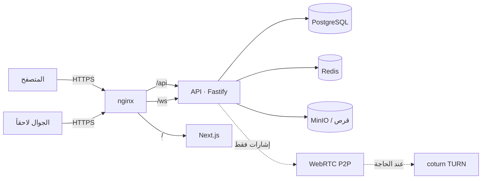

# سيادي · Sovereign

**منصة تواصل سيادية قابلة للاستضافة الذاتية** — مراسلة فورية، قنوات بث، شبكة اجتماعية،
ومكالمات صوتية ومرئية WebRTC، كلها تعمل على بنيتك التحتية.

A self-hostable communication platform: real-time messaging, broadcast channels, a social
timeline and peer-to-peer audio/video calls — running entirely on infrastructure you own.

[](LICENSE)


---

## ما هو موجود فعلاً (وما ليس موجوداً)

نكتب هذا المشروع وفق قاعدة صارمة: **لا ندّعي ميزة لم تُنفَّذ ولم تُختبر.**

| الميزة | الحالة |
| --- | --- |
| حساب مستخدم، تسجيل دخول، جلسات متعددة الأجهزة، تدوير رموز التحديث | ✅ منفّذ ومُختبر |
| إعداد الملف الشخصي، الصورة الرمزية، إعدادات الخصوصية، الحظر | ✅ منفّذ ومُختبر |
| محادثات فردية ومجموعات، تاريخ الرسائل، حالات التسليم والقراءة، «يكتب الآن» | ✅ منفّذ ومُختبر |
| مرفقات (صور/فيديو/ملفات) مع فحص النوع والحجم | ✅ منفّذ ومُختبر |
| قنوات عامة/خاصة، أدوار، روابط دعوة، منشورات | ✅ منفّذ ومُختبر |
| شبكة اجتماعية: منشورات، متابعة، إعجاب، تعليق، إعادة نشر، وسوم، بحث | ✅ منفّذ ومُختبر |
| بلاغات وطابور إشراف وسجل تدقيق | ✅ منفّذ ومُختبر |
| مكالمات صوت/فيديو WebRTC (إشارات + TURN) | ⚠️ الإشارات مُختبرة end-to-end؛ **جودة الوسائط تحتاج اختبار جهازين حقيقيين** |
| تطبيق جوال (Expo/React Native) | ⚠️ مصادقة + محادثات + موجز + إعدادات تعمل مع الخادم؛ المكالمات وإشعارات الدفع واختبار الأجهزة الحقيقية متبقية |
| التشفير الطرفي (Signal Protocol) | ⚠️ الخادم يوزّع المفاتيح العامة وينقل النص المشفّر دون قراءته (مُختبر بجلسة libsignal حقيقية، معيار قبول 22)، لكن **تطبيقات المستخدم النهائي لا تُشفّر بعد** — لذا `E2EE_ENABLED=false` افتراضاً ولا نسمّي المحادثات مشفّرة |
| مكالمات جماعية (SFU/LiveKit) | ⚠️ الكود يدعمها وتُعيد الخدمة 503 عند عدم إعدادها — غير مُختبرة |
| Docker Compose + nginx + coturn + نسخ احتياطي | ✅ ملفات جاهزة (تحتاج تجربة على خادم حقيقي) |

التفاصيل الكاملة والدليل على كل بند: [`docs/feature-log.md`](docs/feature-log.md).

---

## البدء السريع (تطوير محلي)

المتطلبات: Node.js 22+ فقط. لا حاجة إلى Docker في التطوير — الخادم يشغّل PostgreSQL 16 مدمجاً.

```bash
npm install                 # تثبيت مساحات العمل
npm run dev                 # يشغّل الخادم (:8787) والویب (:3000) معاً
npm run seed                # بيانات تجريبية + حسابات للدخول
```

ثم افتح <http://localhost:3000> وسجّل الدخول بـ `layla` / `Sovereign-Demo-2026`.

```bash
npm run test:all            # 36 اختبار وحدة + 18 اختبار قبول شامل
npm run smoke               # فحص شامل ضد خادم يعمل فعلاً
npm run check:api           # 42 فحصاً لعقود الواجهة (REST + WebSocket + الوسائط) بين الويب والخادم
npm run typecheck           # فحص الأنواع في الخادم والویب
```

دليل مفصّل: [`docs/run-local.md`](docs/run-local.md).

## النشر على خادمك

```bash
cp .env.example .env        # املأ كلمات المرور والمفاتيح وDOMAIN
docker compose -f infra/docker-compose.yml up -d --build
```

يشمل: PostgreSQL، Redis، MinIO، coturn، الخادم، الویب، وnginx كمُدخل TLS وحيد.
دليل النشر خطوة بخطوة: [`docs/deploy.md`](docs/deploy.md) ·
النسخ والاستعادة: [`docs/backup-restore.md`](docs/backup-restore.md).

---

## البنية

```
apps/server      واجهة برمجة Fastify 5 + PostgreSQL 16 + بوابة WebSocket
apps/web         عميل Next.js 15 (App Router) عربي RTL/إنجليزي LTR
packages/shared  الأنواع + مخططات التحقق zod + بروتوكول الوقت الحقيقي (مشترك)
infra/           Docker Compose، Dockerfiles، nginx، coturn، سكربتات النسخ الاحتياطي
docs/            العمارة، واجهة البرمجة، النشر، الأمن، سجل الميزات
```

طبقات الخادم: `routes → services → domain (repositories)` مع حقن التبعيات عبر
`ServiceContainer`، و`RequestContext` يحمل (IP، وكيل المستخدم، معرّف الطلب، المستخدم،
الجلسة، الجهاز). كل استعلام SQL معامل ولا يُبنى بالنصوص.



المزيد: [`docs/architecture.md`](docs/architecture.md).

## الأمان (ملخص صادق)

- كلمات المرور: Argon2id (مع scrypt كبديل عند غياب الوحدة الأصلية).
- رموز الوصول: JWT قصيرة العمر (15 دقيقة)؛ رموز التحديث: عشوائية 32 بايت، مُخزّنة كـ SHA-256،
  وتُدوَّر مع كشف إعادة الاستخدام وإلغاء سلسلة الرموز كاملة.
- التحقق بخطوتين (TOTP) مع تشفير السر في السكون عبر AES-256-GCM.
- تحديد معدل الطلبات، سجل تدقيق، تحقق مخططات zod على كل مدخل، واستعلامات معاملة.
- **الرسائل ليست مشفّرة طرفياً بعد.** محمية أثناء النقل (TLS) ومخزّنة على خادمك.
  لا نستخدم كلمة «تشفير طرفي» إلا بعد تنفيذ Signal Protocol واجتياز اختباراته.

التقرير الكامل مع المخاطر المتبقية: [`docs/security-report.md`](docs/security-report.md).

## الرخصة

AGPL-3.0-or-later — يمكنك استخدامه وتعديله واستضافته، بشرط إتاحة الشفرة للتعديلات
عند تقديمه كخدمة شبكية. انظر [LICENSE](LICENSE).
